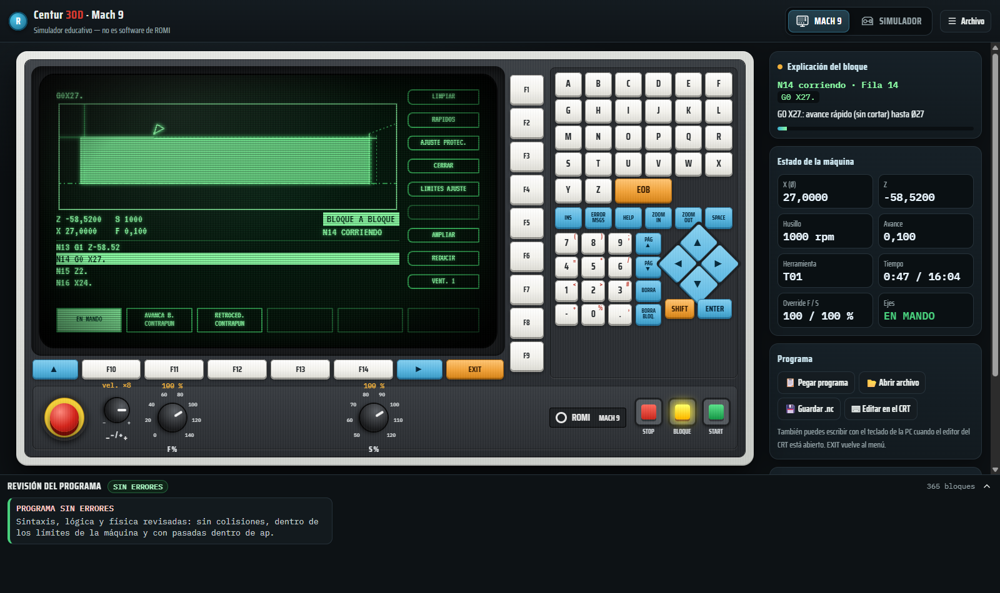
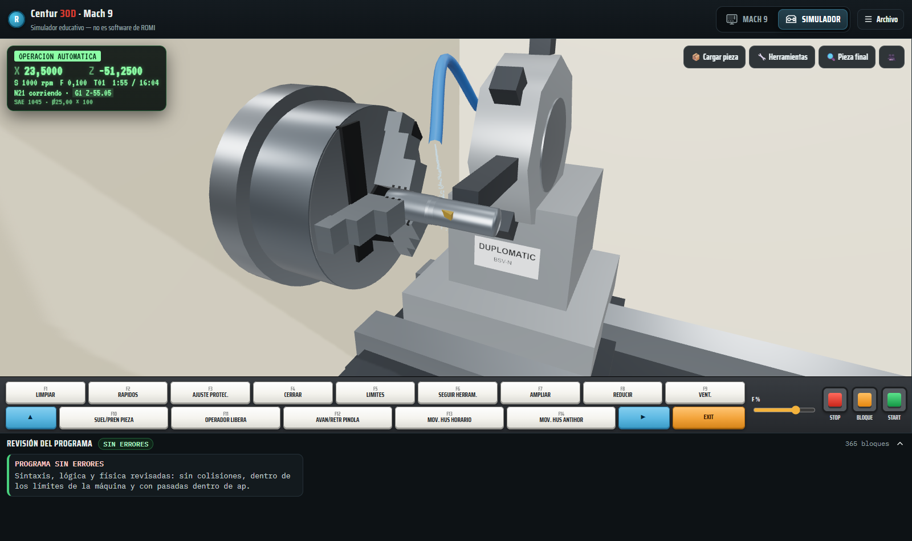
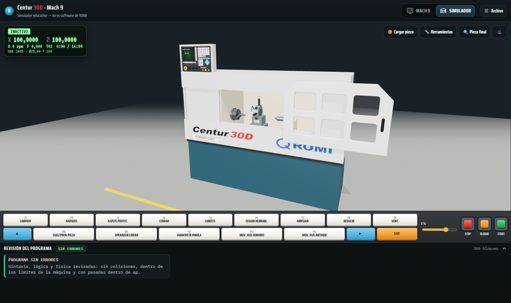
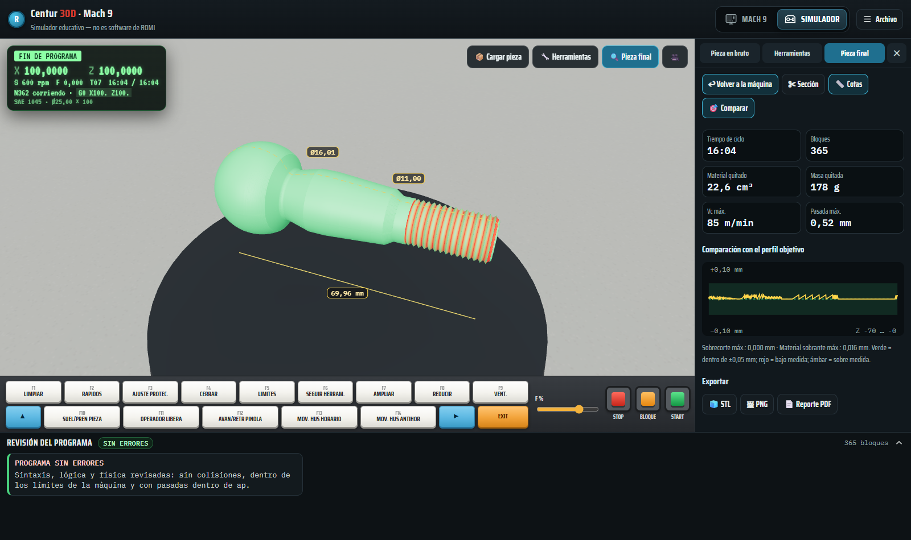
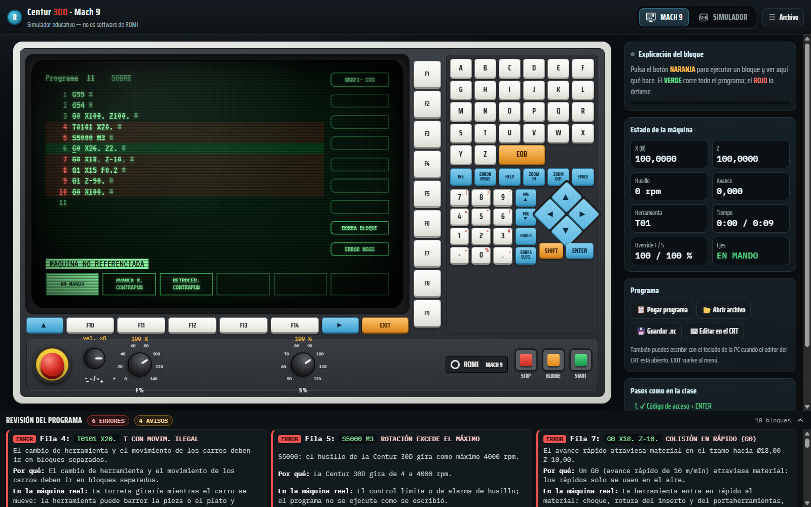

# Simulador Centur 30D · Mach 9

Simulador **educativo** del torno CNC **ROMI Centur 30D** con control **Mach 9**, para PC y celular.
Réplica del panel Mach 9 con su monitor verde, revisión automática de errores explicada en español sencillo y la
máquina completa en 3D cortando la pieza.

> ⚠️ **Aviso:** es un simulador educativo hecho para la clase de CNC. **No es software de ROMI** ni está afiliado
> a Indústrias Romi S.A. Los nombres ROMI, Centur y Mach 9 pertenecen a sus dueños. No reemplaza al manual ni al docente:
> antes de ejecutar un programa en la máquina real, verifícalo con el docente.

<p align="center">
  <a href="https://github.com/angelja19/simulador-centur-30d/releases/latest/download/Simulador-Centur-30D-Setup.exe"></a>
  &nbsp;
  <a href="https://angelja19.github.io/simulador-centur-30d/"></a>
</p>



| Simulador completo (zona de corte) | La máquina completa |
|---|---|
|  |  |
| **Pieza final: cotas y comparación con el perfil** | **Panel de errores con explicaciones** |
|  |  |

## Instalar

**Windows (PC):** descarga [Simulador-Centur-30D-Setup.exe](https://github.com/angelja19/simulador-centur-30d/releases/latest/download/Simulador-Centur-30D-Setup.exe)
y ejecútalo. Como el instalador no está firmado, Windows puede decir "Windows protegió su PC": elige
**Más información → Ejecutar de todas formas**. Funciona sin internet.

**Celular Android (ej. Samsung S23+):** abre <https://angelja19.github.io/simulador-centur-30d/> en **Chrome** →
menú **⋮** → **Instalar app** (o *Agregar a la pantalla de inicio*). Queda como una app más y funciona **sin internet**.
Se usa en vertical y en horizontal.

**PC sin instalar nada:** abre el mismo enlace en Chrome o Edge (también se puede instalar con el ícono ⊕ de la barra de direcciones).

## Cómo se usa (igual que en la clase)

1. **Pantalla MACH 9** (ícono del monitor). Escribe un código de acceso con el teclado y **ENTER** → *COD ACCESO-2*.
2. Con **►** busca **EN MANDO** en la fila de abajo y pulsa **F10**: se conectan los ejes. **EXIT** hasta la *PÁGINA DE MODO*.
3. **F7 MANUAL → F5 REFER. MAQUINA → botón verde**: la máquina se referencia (sin esto no simula).
4. **F2 EDITOR**, escribe el número de programa y **ENTER**. Escribe el programa tecla por tecla
   (la máquina pone el espacio sola, **EOB** pasa al bloque siguiente) o pega uno con **Archivo → Pegar programa**.
5. **F1 GRÁFICOS** (o F5 AUTO) y:
   - **verde** = CYCLE START: corre todo el programa;
   - **naranja** = bloque a bloque: ejecuta un bloque por pulsación y explica qué hace;
   - **rojo** = CYCLE STOP (dos veces seguidas = abortar).
6. **Pantalla SIMULADOR** (ícono del torno): *Cargar pieza* (material, diámetro, longitud, largo sujeto),
   las garras se cierran, y con los mismos botones ves la máquina cortando. Al terminar: *Pieza final*
   (girar, acercar, sección, cotas y comparación con el perfil objetivo).

La guía completa de la clase está en [docs/guia_docente.md](docs/guia_docente.md) y las teclas F del simulador 3D en
[docs/teclas_F.md](docs/teclas_F.md).

## Qué hace

**Pantalla 1 — MACH 9**
- Panel réplica: F1–F9 en columna, F10–F14 con ▲ ► y EXIT, teclado A–Z con EOB, fila azul (INS, ERROR MSGS, HELP,
  ZOOM IN/OUT, SPACE), teclado numérico con símbolos (SHIFT), ENTER, cursores en rombo, parada de emergencia,
  selector − / +, perillas F (0–140 %) y S (50–120 %) y los botones rojo, naranja y verde. Todo funciona.
- Páginas del CRT como en el video: ACCESO, MODO, EDITOR, DIRECTORIO, edición del programa, GRÁFICOS/AUTO
  (trayectoria dibujándose con zoom automático, Z y X con 4 decimales, "OPERACION AUTOMATICA", "N13 CORRIENDO"),
  MANUAL (referenciar, MDI), REFER. TRABAJO, CARGAR/SALVAR, SOPORTE, mensajes de error y ayuda.
- También se puede escribir con el teclado de la PC.

**Panel de errores (abajo, en las dos pantallas)** — se revisa solo al pegar, escribir o abrir un programa:
- "Fila N: *bloque*", ERROR / AVISO, el mensaje estilo Mach 9, **por qué** es un error, **qué causaría en la máquina
  real**, cómo corregirlo y el botón **Ir a la fila**. Filas con error en rojo y avisos en ámbar en el editor.
- Sintaxis (caracteres, números, decimales, 64 caracteres, funciones repetidas, **cotas sin punto = milésimas**),
  lógica (sin F, sin M3, T con movimiento, arcos imposibles, roscas con rpm alta, sin M02/M30, S con punto) y física
  (G0 dentro del material, choque con el plato, pasadas mayores que ap, carreras X 220 / Z 1065, rpm > 4000,
  volteo, potencia del motor de 10 hp, sobrecorte del perfil). Con errores, el botón verde pide confirmación como una alarma.

**Pantalla 2 — Simulador completo**
- Máquina completa en 3D con colores ROMI: base azul petróleo, carcasa gris, interior crema, puerta con frente
  hexagonal y 6 ventanas, panel Mach 9, plato de 3 garras, torreta Duplomatic, contrapunta, refrigerante y virutas.
- Pieza en bruto configurable: SAE 1010–1025, 1030–1035, 1045, 1065, 1095, inoxidable, fundición, aluminio, latón,
  bronce, cobre y nylon (color y brillo propios; sus datos de corte se usan en el cálculo de potencia), medidas
  comerciales, longitud y largo sujeto; se valida contra la máquina (volteo Ø 350, agujero del husillo Ø 53,
  entre puntas 1000 mm).
- Choques, plato, pieza suelta: destello, chispas y explicación en el panel de errores.

**Mejoras**: F y S separados para desbaste y acabado, G96 con límite G92, radio de punta de la herramienta,
biblioteca de herramientas (torreta de 8 posiciones) y de materiales, roscas ISO métricas, generador de programa
desde un perfil (CAM del HTML original) y exportar **.nc**, **PNG**, **STL** y **reporte PDF**.

## Datos de la máquina usados

ROMI Centur 30D, control Mach 9 · motor 10 hp (380-220 V, 50 Hz, 6,1 A, direct drive) · husillo 4–4000 rpm,
agujero Ø 53 mm · altura de punta 215 mm · entre puntas 1000 mm · volteo Ø 350 mm · Ø sobre el carro 200 mm ·
carrera X 220 mm, Z 1065 mm · rápido 10 m/min · torreta Duplomatic BSV-N (opción gang) · plato de 3 garras.
Ver [`src/core/machine.js`](src/core/machine.js).

## Pendientes / dudas (no se inventó nada: esto queda por confirmar)

- **No estaba la carpeta `referencia/`** (`fotos_maquina.pdf` y el video corto de la pantalla en automático):
  la apariencia se tomó solo del video de la clase N° 6.
- **Torreta**: "aparentemente 8 posiciones"; no se pudieron contar en el video.
- Las **4 teclas azules** junto al teclado numérico no se leen en el video: en la app son PÁG ▲, PÁG ▼, BORRA y BORRA BLOQ.
  Los **símbolos con SHIFT** del teclado numérico son una aproximación.
- Nombres exactos de algunos grupos de F10–F14 (refrigeración, incremento/decremento, seguridad de puerta, plato externo).
- Posición exacta de las teclas **RÁPIDOS**, **REFERENCIAR MÁQUINA** y **MDI** (se oyen en la clase, no se ven): en la app F2, F5 y F4.
- El **código de acceso** del operador no se publica: la app acepta cualquiera y da el nivel 2.
- **G99** como primer bloque se acepta tal como lo enseña el docente; el simulador no le asigna otro efecto.
- En el audio se oye un máximo de rotación de "3600" en un ejemplo; se usa el dato de la ficha (4000 rpm).
- Al final de la clase se menciona **G50**; no se entendió el contexto y no se simula.
- Diámetro del plato (Ø 165) y profundidad de las garras (40 mm) son estimaciones.
- La regla "una cota sin punto se lee en milésimas" y "S con punto = velocidad de corte" vienen de la explicación del
  docente (minutos 44:14 y 20:20); conviene confirmarlas con el manual de la máquina.

## Desarrollo

```bash
npm install
npm run dev        # servidor de desarrollo
npm test           # pruebas (incluye la prueba de oro del núcleo original)
npm run build      # versión web/PWA en dist/
npm run dist:win   # instalador de Windows en release/
```

- `legacy/` — el HTML original del simulador (referencia de la prueba de oro).
- `src/core/` — núcleo M9: `parse`, `interpret`, `Sim`, `cam`, `KS` (sin cambios de lógica, verificado con
  `tests/golden.test.js`) + `machine.js`, `analyze.js`, `explain.js`, `library.js`.
- `src/screens/` — Pantalla 1 (`mach9.js`, `graph.js`) y Pantalla 2 (`sim3d.js`, `machine3d.js`).
- three.js y las fuentes están incluidas localmente (no se usan CDN).
- GitHub Actions publica la PWA en GitHub Pages en cada push a `main` y genera el `.exe` en Releases con cada tag `v*`.

## Licencia

[MIT](LICENSE) — © 2026 angelja19.
